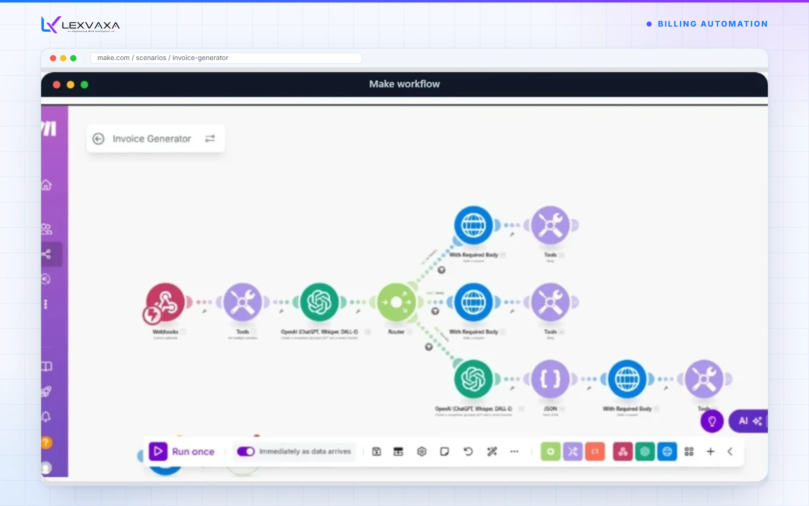

# GoHighLevel & NMI Billing Automation

**A Make automation that connects GoHighLevel with the NMI payment gateway to run billing on schedule and track every transaction.**

      

## Overview

Manual invoice processing and inconsistent payment tracking created unnecessary admin work. Lexvaxa built a billing automation in Make that connects GoHighLevel with the NMI payment gateway. It runs scheduled billing and payment runs, logs and tracks every transaction, retries failed payments with error handling and sends alert notifications to the team. Screens shown use sample data, so no client records are exposed.

## The challenge

Invoices and payments were handled by hand, so billing was slow and payment status was hard to trust.

## The solution

A Make scenario with webhooks, an invoice generator, routers and API calls between GoHighLevel and NMI, with retries and alerts built in.

## Key features

- Scheduled billing and payment runs
- Transaction logging and tracking
- Failed-payment retries and error handling
- Alert notifications
- GoHighLevel records kept in sync

## Results

- Payments run on schedule and every transaction is tracked, removing manual billing work

## Tech stack

Make · GoHighLevel · NMI API · Webhooks · OpenAI

## Privacy

Client names and records are confidential. Every screen in this repository uses sample data, and source code that belongs to the client is not published.

## Links

- Case study on Lexvaxa: https://lexvaxa.com/work/ghl-nmi-billing-automation
- Built by **Ch Muhammad Samiullah** ([GitHub](https://github.com/samiullah156-creator)) at [Lexvaxa](https://lexvaxa.com)
